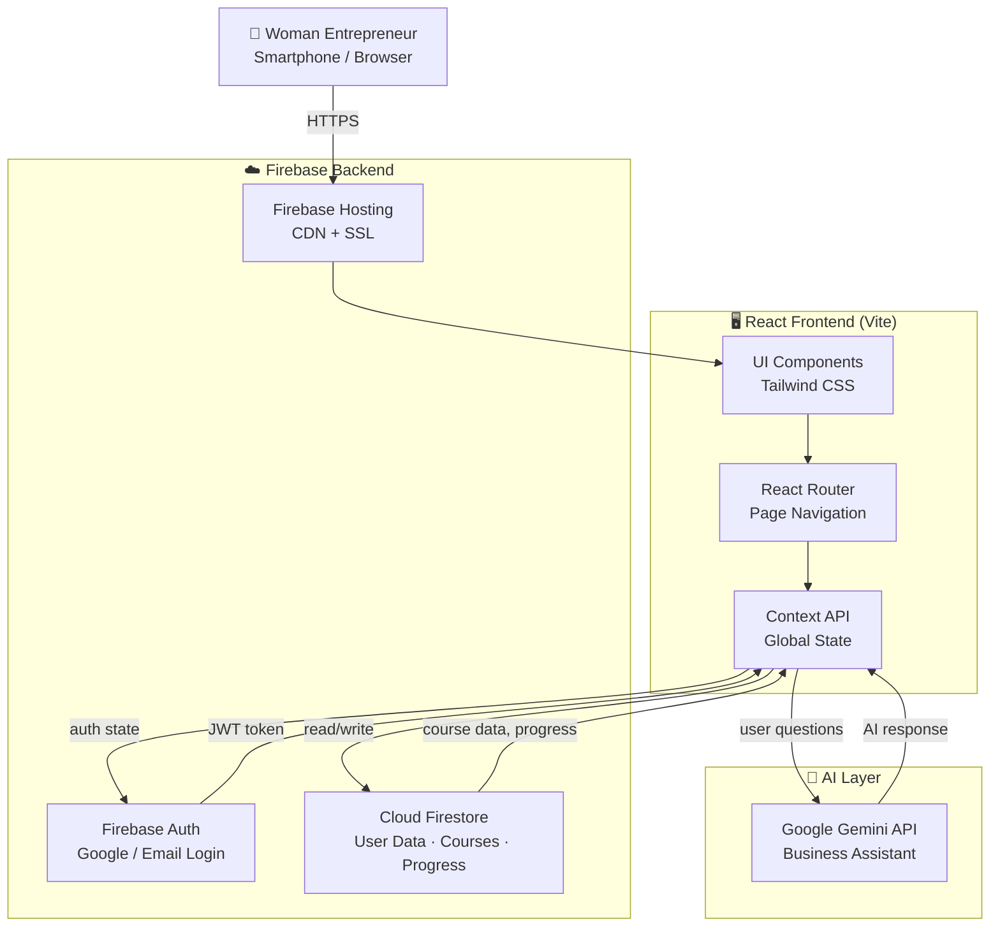

<div align="center">

<!-- ANIMATED HERO BANNER -->


<br/>

<h3>
  <em>A Regional E-Learning Platform for Women Entrepreneurs across India</em>
</h3>

<p align="center">
  <b>Financial Literacy · Digital Skills · Business Management · Entrepreneurship · Regional Languages</b>
</p>

<br/>

<!-- BADGE ROW -->
<p>
  
  
  
  
  
  
</p>
<p>
  
  
  
  
  
</p>

<br/>

<!-- QUICK NAVIGATION -->
<p>
  <a href="#about-the-project">About</a> ·
  <a href="#problem-statement">Problem</a> ·
  <a href="#key-features">Features</a> ·
  <a href="#technology-stack">Tech Stack</a> ·
  <a href="#system-architecture">Architecture</a> ·
  <a href="#project-structure">Structure</a> ·
  <a href="#getting-started">Getting Started</a> ·
  <a href="#roadmap">Roadmap</a> ·
  <a href="#contributing">Contribute</a>
</p>

<br/>


</div>

## 📋 Table of Contents

- [About the Project](#about-the-project)
- [Problem Statement](#problem-statement)
- [Our Solution](#our-solution)
- [Key Features](#key-features)
- [Screenshots](#screenshots)
- [Technology Stack](#technology-stack)
- [System Architecture](#system-architecture)
- [Project Structure](#project-structure)
- [Getting Started](#getting-started)
  - [Prerequisites](#prerequisites)
  - [Installation](#installation)
  - [Environment Variables](#environment-variables)
  - [Firebase Setup](#firebase-setup)
  - [Running Locally](#running-locally)
- [Available Scripts](#available-scripts)
- [Security and Privacy](#security-and-privacy)
- [Deployment](#deployment)
- [Roadmap](#roadmap)
- [Contributing](#contributing)
- [License](#license)
- [Acknowledgements](#acknowledgements)
- [Contact](#contact)


## 🌿 About the Project

**SakhiBiz** is an open-source, regional-language e-learning platform designed specifically for **rural and semi-urban women entrepreneurs** across India. The platform bridges the gap between formal business education and the millions of self-employed women — artisans, shopkeepers, home-based producers, micro-enterprise owners — who lack access to affordable, accessible, and culturally relevant business knowledge.

Unlike generic online learning platforms that assume English fluency and urban internet access, SakhiBiz delivers **bite-sized, practical lessons** in regional languages, covering the exact skills women entrepreneurs need: understanding profit margins, pricing their products fairly, managing expenses, using digital payment tools, protecting themselves online, and growing their customer base.

> *"Knowledge should never be a privilege. When a woman understands her business, her family and community grow with her."*

SakhiBiz is built with modern web technologies, optimized for low-bandwidth devices, and designed around the real workflows of women running micro and small businesses in India.


## 🎯 Problem Statement

Despite India having over **63 million micro, small, and medium enterprises**, a significant portion run by women face deep structural barriers to business growth:

| Challenge | Impact |
|-----------|--------|
| 🔤 **Language barriers** | Most business education is in English or formal Hindi, excluding regional-language speakers |
| 📊 **Financial literacy gap** | Many entrepreneurs cannot calculate profit, track expenses, or understand pricing |
| 📵 **Limited digital access** | Complex apps designed for urban users are unusable for first-time smartphone owners |
| 🏫 **No structured learning** | No beginner-friendly, step-by-step curriculum for micro-business management |
| 🔒 **Digital safety risks** | Vulnerable to online fraud, fake UPI requests, and misinformation |
| 💸 **No practical tools** | Spreadsheets and accounting software are inaccessible without training |

> Women-led businesses account for a small fraction of formally registered MSMEs, not because of lack of ambition, but because of lack of accessible support systems.


## 💡 Our Solution

SakhiBiz addresses these challenges by providing:

<table>
  <tr>
    <td align="center">🗣️</td>
    <td><b>Regional Language Education</b><br/>Courses and UI available in Hindi and other regional languages, making learning comfortable for first-time digital learners</td>
  </tr>
  <tr>
    <td align="center">📚</td>
    <td><b>Structured Learning Paths</b><br/>Beginner-to-advanced curricula covering financial literacy, marketing, digital tools, and business planning</td>
  </tr>
  <tr>
    <td align="center">🧮</td>
    <td><b>Practical Business Tools</b><br/>Built-in profit calculator and expense tracker so women can apply lessons immediately to their real businesses</td>
  </tr>
  <tr>
    <td align="center">🤖</td>
    <td><b>AI-Powered Assistance</b><br/>Conversational AI guide (powered by Google Gemini) answers business questions in plain, accessible language</td>
  </tr>
  <tr>
    <td align="center">📱</td>
    <td><b>Mobile-First Design</b><br/>Optimized for low-end smartphones and slower internet connections used in Tier 2–3 cities and rural areas</td>
  </tr>
  <tr>
    <td align="center">🔒</td>
    <td><b>Digital Safety Education</b><br/>Dedicated module teaching women to recognize fraud, protect their UPI credentials, and stay safe online</td>
  </tr>
</table>


## ✨ Key Features

### 🎓 Learning & Education

| Feature | Description | Status |
|---------|-------------|--------|
| 📖 **Course Catalogue** | Organized library of business courses by topic and skill level | ✅ Implemented |
| 🎯 **Structured Lessons** | Step-by-step lessons with clear objectives and takeaways | ✅ Implemented |
| 📊 **Progress Tracking** | Personal learning dashboard showing completed lessons and progress | ✅ Implemented |
| 🧠 **Quizzes & Assessments** | Comprehension checks after each lesson module | ✅ Implemented |
| 🌐 **Regional Language Content** | Hindi-first content with regional language support | ✅ Implemented |

### 💼 Business Tools

| Feature | Description | Status |
|---------|-------------|--------|
| 🧮 **Profit Calculator** | Calculate selling price, cost, and profit margin in seconds | ✅ Implemented |
| 📒 **Expense Tracker** | Log and categorize daily business expenses | ✅ Implemented |
| 📋 **Business Planning Resources** | Guided templates and planning tools for micro-enterprises | ✅ Implemented |
| 💹 **Financial Literacy Module** | Practical lessons on budgeting, savings, and pricing | ✅ Implemented |

### 🛡️ Safety & Empowerment

| Feature | Description | Status |
|---------|-------------|--------|
| 🔐 **Digital Safety Education** | Courses on online fraud, UPI safety, and cyber hygiene | ✅ Implemented |
| 👤 **Personalized Dashboard** | Individual learner profile with recommended courses | ✅ Implemented |
| 🤖 **AI Learning Assistant** | Ask business questions, get plain-language answers via Gemini AI | ✅ Implemented |
| 🔑 **Secure Authentication** | Google Sign-In and email/password via Firebase Auth | ✅ Implemented |

### 🔮 Planned Features

| Feature | Status |
|---------|--------|
| 🗣️ Voice-based lessons for low-literacy users | 🔲 Planned |
| 📥 Downloadable offline lesson packs | 🔲 Planned |
| 🏅 Certificates on course completion | 🔲 Planned |
| 👥 Peer community and mentor network | 🔲 Planned |
| 📲 Progressive Web App (PWA) offline support | 🔲 Planned |


## 📸 Screenshots

> **Note:** Screenshots will be added here once the application is deployed. The section below shows where they belong.

```
📂 Add your screenshots to: /public/screenshots/
   ├── dashboard.png        — Main learner dashboard
   ├── courses.png          — Course catalogue
   ├── lesson.png           — Lesson view
   ├── profit-calculator.png — Business tools
   └── mobile-view.png      — Mobile-responsive view
```

To add screenshots after your first deployment:

```md
<p align="center">
  
  
</p>
```

**Live Demo:** _Not yet deployed — link will be added here_


## 🛠 Technology Stack

### Frontend

| Technology | Version | Role |
|------------|---------|------|
|  **React** | 18.x | Core UI library, component architecture |
|  **Vite** | 5.x | Build tool and development server |
|  **Tailwind CSS** | 3.x | Utility-first CSS styling |
| **React Router** | 6.x | Client-side routing and navigation |

### Backend & Database

| Technology | Role |
|------------|------|
|  **Firebase Firestore** | NoSQL database for user data, course content, progress |
|  **Firebase Authentication** | Google Sign-In and email/password auth |
| **Firebase Hosting** | Static hosting with CDN for production deployment |

### AI Integration

| Technology | Role |
|------------|------|
|  **Google Gemini API** | AI-powered business assistant, Q&A, lesson explanations |

### Development Tools

| Technology | Role |
|------------|------|
| **ESLint** | Code quality and linting |
| **npm / yarn** | Package management |
| **Git** | Version control |


## 🏗 System Architecture



### Component Responsibilities

- **React Frontend** — All UI rendering, routing between pages, and user interactions. State managed via React Context API.
- **Firebase Authentication** — Handles user identity. Supports Google OAuth and email/password. Issues JWT tokens that the Firestore security rules validate.
- **Cloud Firestore** — Stores user profiles, course catalogue, lesson content, quiz results, progress tracking, and business tool data. Secured with Firestore Rules.
- **Google Gemini API** — Provides the AI business assistant. Queries are sent from the frontend with the user's question and relevant context; responses are streamed back.
- **Firebase Hosting** — Serves the production build from a global CDN with automatic SSL.


## 📁 Project Structure

```
SakhiBiz/
├── public/                     # Static assets served directly
│   ├── favicon.ico
│   └── screenshots/            # App screenshots (add after deployment)
│
├── src/
│   ├── assets/                 # Images, icons, illustrations
│   ├── components/             # Reusable UI components
│   │   ├── Navbar.jsx
│   │   ├── CourseCard.jsx
│   │   ├── LessonViewer.jsx
│   │   ├── QuizModule.jsx
│   │   ├── ProgressBar.jsx
│   │   ├── AIAssistant.jsx
│   │   └── ...
│   ├── pages/                  # Top-level route pages
│   │   ├── Home.jsx
│   │   ├── Dashboard.jsx
│   │   ├── Courses.jsx
│   │   ├── LessonPage.jsx
│   │   ├── BusinessTools.jsx
│   │   ├── ProfitCalculator.jsx
│   │   ├── ExpenseTracker.jsx
│   │   ├── Login.jsx
│   │   └── ...
│   ├── context/                # React Context providers
│   │   ├── AuthContext.jsx     # Firebase auth state
│   │   └── AppContext.jsx      # Global app state
│   ├── firebase/               # Firebase configuration
│   │   ├── config.js           # Firebase app init (uses env vars)
│   │   └── firestore.js        # Firestore helper functions
│   ├── services/               # External service integrations
│   │   └── gemini.js           # Google Gemini API calls
│   ├── utils/                  # Pure utility functions
│   ├── hooks/                  # Custom React hooks
│   ├── App.jsx                 # Root component, routing setup
│   └── main.jsx                # App entry point
│
├── .env.example                # Environment variable template
├── .gitignore
├── package.json
├── vite.config.js
├── tailwind.config.js
├── firestore.rules             # Firestore security rules
└── README.md
```

> **Note:** Inspect the actual repository for the precise file layout. The above reflects a typical React + Firebase + Vite structure for this type of application.


## 🚀 Getting Started

### Prerequisites

Before you begin, ensure you have the following installed:

| Tool | Minimum Version | Check Command |
|------|----------------|---------------|
| **Node.js** | 18.x or later | `node --version` |
| **npm** | 9.x or later | `npm --version` |
| **Git** | Any recent | `git --version` |

You also need:
- A **Google / Firebase account** (free tier works for development)
- A **Google AI Studio account** for the Gemini API key ([Get one free](https://aistudio.google.com))

---

### Installation

**1. Clone the repository**

```bash
git clone https://github.com/tech-by-niteshh/SakhiBiz.git
cd SakhiBiz
```

**2. Install dependencies**

```bash
npm install
```

---

### Environment Variables

Create a `.env` file in the project root based on the template below. **Never commit your actual keys to Git.**

```bash
cp .env.example .env
```

**.env.example**

```env
# ─── Firebase Configuration ───────────────────────────────────────────────────
# Get these from: Firebase Console → Project Settings → Your Apps → Web App
VITE_FIREBASE_API_KEY=YOUR_FIREBASE_API_KEY_HERE
VITE_FIREBASE_AUTH_DOMAIN=YOUR_PROJECT_ID.firebaseapp.com
VITE_FIREBASE_PROJECT_ID=YOUR_PROJECT_ID_HERE
VITE_FIREBASE_STORAGE_BUCKET=YOUR_PROJECT_ID.appspot.com
VITE_FIREBASE_MESSAGING_SENDER_ID=YOUR_SENDER_ID_HERE
VITE_FIREBASE_APP_ID=YOUR_FIREBASE_APP_ID_HERE

# ─── Google Gemini AI ──────────────────────────────────────────────────────────
# Get this from: https://aistudio.google.com/app/apikey
VITE_GEMINI_API_KEY=YOUR_GEMINI_API_KEY_HERE
```

> ⚠️ All variables start with `VITE_` because Vite only exposes variables with this prefix to the frontend. Never store backend secrets in a Vite app's `.env` file.

---

### Firebase Setup

**Step 1: Create a Firebase project**

1. Go to [Firebase Console](https://console.firebase.google.com)
2. Click **Add project** → name it (e.g. `sakhib-dev`)
3. Disable Google Analytics if not needed → **Create project**

**Step 2: Register a Web App**

1. In your project, click the `</>` (Web) icon
2. Register the app, give it a nickname
3. Copy the `firebaseConfig` values into your `.env` file

**Step 3: Enable Authentication**

1. Go to **Authentication** → **Sign-in method**
2. Enable **Google** and/or **Email/Password** providers
3. Add your local dev domain (`localhost`) to authorized domains

**Step 4: Create Firestore Database**

1. Go to **Firestore Database** → **Create database**
2. Start in **test mode** for local development
3. Choose your region (e.g. `asia-south1` for India)

**Step 5: Apply Firestore Security Rules**

Copy the contents of `firestore.rules` (in the project root) and paste them into **Firestore → Rules** in the Firebase Console, then **Publish**.

---

### Running Locally

```bash
npm run dev
```

The application will be available at **http://localhost:5173**


## 📜 Available Scripts

| Command | Description |
|---------|-------------|
| `npm run dev` | Start the Vite development server with hot-reload |
| `npm run build` | Create an optimized production build in `/dist` |
| `npm run preview` | Preview the production build locally before deploying |
| `npm run lint` | Run ESLint to check for code issues |

> Run `npm run build` and inspect the output in `/dist` before any deployment.


## 🔒 Security and Privacy

SakhiBiz handles personal data from vulnerable users. Security is a first-class concern.

### Implemented Practices

- **Authentication** — Firebase Auth handles all identity management. Passwords are never stored by the application.
- **Authorization** — Firestore Security Rules enforce that users can only read and write their own documents. No user can access another user's data.
- **API Key Management** — All API keys are stored as environment variables and never hard-coded. The `.env` file is excluded by `.gitignore`.
- **Input Validation** — User inputs are validated on the frontend before being written to Firestore.
- **HTTPS Only** — Firebase Hosting serves all content over HTTPS with automatic SSL certificates.

### User Safety Guidelines

> ⚠️ **Important reminders for users of the platform:**
> - SakhiBiz will **never** ask for your UPI PIN, bank password, or OTP.
> - Do not share your login credentials with anyone.
> - If you receive a suspicious call or message claiming to be from SakhiBiz, do not share any financial information.

### Responsible Disclosure

If you discover a security vulnerability, please **do not open a public GitHub issue**. Instead, email the maintainer directly at the address listed in the [Contact](#contact) section with the subject line `[SECURITY] SakhiBiz Vulnerability Report`. We aim to respond within 72 hours.


## ☁️ Deployment

SakhiBiz is designed to deploy on **Firebase Hosting**.

### Deploy to Firebase Hosting

**1. Install Firebase CLI**

```bash
npm install -g firebase-tools
```

**2. Log in and initialize**

```bash
firebase login
firebase init hosting
```

When prompted:
- Select your Firebase project
- Set public directory to: `dist`
- Configure as single-page app: `Yes`
- Do not overwrite `dist/index.html`: `No`

**3. Build and deploy**

```bash
npm run build
firebase deploy --only hosting
```

**4. Configure environment variables for production**

For production builds, set your environment variables in your CI/CD pipeline or use a `.env.production` file (excluded from Git). Never commit production keys.

**5. Verify deployment**

After deploying, Firebase provides a live URL like `https://YOUR_PROJECT_ID.web.app`. Test:
- Authentication (sign up, sign in, sign out)
- Course loading from Firestore
- AI assistant responses
- Firestore read/write for progress tracking

> 💡 **Alternative platforms:** This Vite app can also be deployed on Vercel or Netlify by setting the build command to `npm run build` and the output directory to `dist`. Set environment variables in your platform's dashboard.


## 🗺️ Roadmap

### ✅ Completed

- [x] Project scaffold with React + Vite + Tailwind CSS
- [x] Firebase Authentication (Google + Email/Password)
- [x] Firestore database integration
- [x] Course catalogue with structured lessons
- [x] Learning progress tracking
- [x] Quiz and assessment modules
- [x] Profit calculator tool
- [x] Expense tracker tool
- [x] Financial literacy course module
- [x] Digital safety education module
- [x] Google Gemini AI business assistant
- [x] Hindi-first content and UI
- [x] Mobile-responsive design

### 🔄 In Progress

- [ ] Expanding regional language support (Marathi, Bengali, Tamil)
- [ ] More business tool templates (invoice generator, simple stock tracker)
- [ ] Improved AI assistant context and accuracy
- [ ] Accessibility improvements (ARIA labels, screen reader support)

### 🔮 Planned

- [ ] Progressive Web App (PWA) with offline lesson access
- [ ] Downloadable PDF lesson summaries
- [ ] Voice-based lessons for low-literacy users
- [ ] Course completion certificates
- [ ] Peer community and discussion forum
- [ ] Mentor matching feature
- [ ] Government scheme navigator (relevant schemes for women entrepreneurs)
- [ ] Integration with digital payment education (UPI, BHIM)
- [ ] Multi-language text-to-speech for lessons


## 🤝 Contributing

Contributions are what make open-source meaningful. SakhiBiz particularly welcomes contributions that help underserved communities.

### How to Contribute

**1. Fork the repository**

```bash
git clone https://github.com/tech-by-niteshh/SakhiBiz.git
```

**2. Create a feature branch**

```bash
git checkout -b feature/your-feature-name
# Examples:
# git checkout -b feature/marathi-translations
# git checkout -b fix/quiz-score-bug
# git checkout -b docs/improve-setup-guide
```

**3. Make focused changes**

Keep each pull request to one clear, well-described change.

**4. Run available checks**

```bash
npm run lint
npm run build   # ensure it builds without errors
```

**5. Commit with a meaningful message**

```bash
git commit -m "feat: add Marathi translations for financial literacy module"
```

**6. Push and open a pull request**

```bash
git push origin feature/your-feature-name
```

Then open a Pull Request on GitHub with a clear title and description of what your change does and why.

---

### We especially welcome contributions involving:

- 🌐 **Regional language translations** — Hindi, Marathi, Bengali, Tamil, Telugu, Kannada, Gujarati
- 📚 **Educational content** — New lessons, quizzes, business case studies
- ♿ **Accessibility** — ARIA, keyboard navigation, screen reader support
- 🐛 **Bug fixes** — Issues affecting any user
- 🎨 **UI improvements** — Better mobile experience, readability
- 📖 **Documentation** — Setup guides, content authoring docs
- 🧪 **Testing** — Unit tests, integration tests

> There is currently no formal Contributor License Agreement. By submitting a pull request, you agree that your contribution may be included in the project.


## 📄 License

> ⚠️ **No license has been specified in this repository yet.**

A license is required for others to legally use, modify, or distribute this software. We recommend choosing one:

| License | Best for |
|---------|----------|
| [MIT License](https://choosealicense.com/licenses/mit/) | Maximum openness, commercial use allowed |
| [Apache 2.0](https://choosealicense.com/licenses/apache-2.0/) | Openness + explicit patent protection |
| [GPL v3](https://choosealicense.com/licenses/gpl-3.0/) | Ensures all derivatives stay open-source |

👉 Visit [choosealicense.com](https://choosealicense.com) to pick the right one, then add a `LICENSE` file to this repository.


## 🙏 Acknowledgements

SakhiBiz is built on the shoulders of outstanding open-source tools and services:

- [**React**](https://react.dev/) — The UI library that powers our frontend
- [**Vite**](https://vitejs.dev/) — Blazing-fast build tooling
- [**Tailwind CSS**](https://tailwindcss.com/) — Utility-first styling
- [**Firebase**](https://firebase.google.com/) — Authentication, database, and hosting
- [**Google Gemini**](https://deepmind.google/technologies/gemini/) — AI-powered learning assistance
- [**React Router**](https://reactrouter.com/) — Client-side navigation
- [**Shields.io**](https://shields.io/) — Beautiful README badges
- [**readme-typing-svg**](https://github.com/DenverCoder1/readme-typing-svg) — Animated typing SVG for the hero section

Special thanks to the women entrepreneurs whose lived experiences and feedback shaped the direction of this platform.


## 📬 Contact

| | |
|--|--|
| **Project** | SakhiBiz — Regional E-Learning for Women Entrepreneurs |
| **GitHub Repository** | [github.com/tech-by-niteshh/SakhiBiz](https://github.com/tech-by-niteshh/SakhiBiz) ← _update this_ |
| **Issue Tracker** | [github.com/tech-by-niteshh/SakhiBiz/issues](https://github.com/tech-by-niteshh/SakhiBiz/issues) |
| **Maintainer** | [@TECH_BY_NITESHH](https://github.com/tech-by-niteshh) ← |
| **Email** | `niteshh@sakhibiz.xyz` |
| **Live Demo** | [https://sakhibiz.xyz](https://sakhibiz.xyz) |

> To report a bug or request a feature, please [open an issue](https://github.com/tech-by-niteshh/SakhiBiz/issues/new).

<br/>

<div align="center">


<br/>

**⭐ If SakhiBiz is useful to you or inspires your work, please star the repository. It helps others find this project.**

<br/>


*SakhiBiz — Empowering Women, One Skill at a Time*

</div>