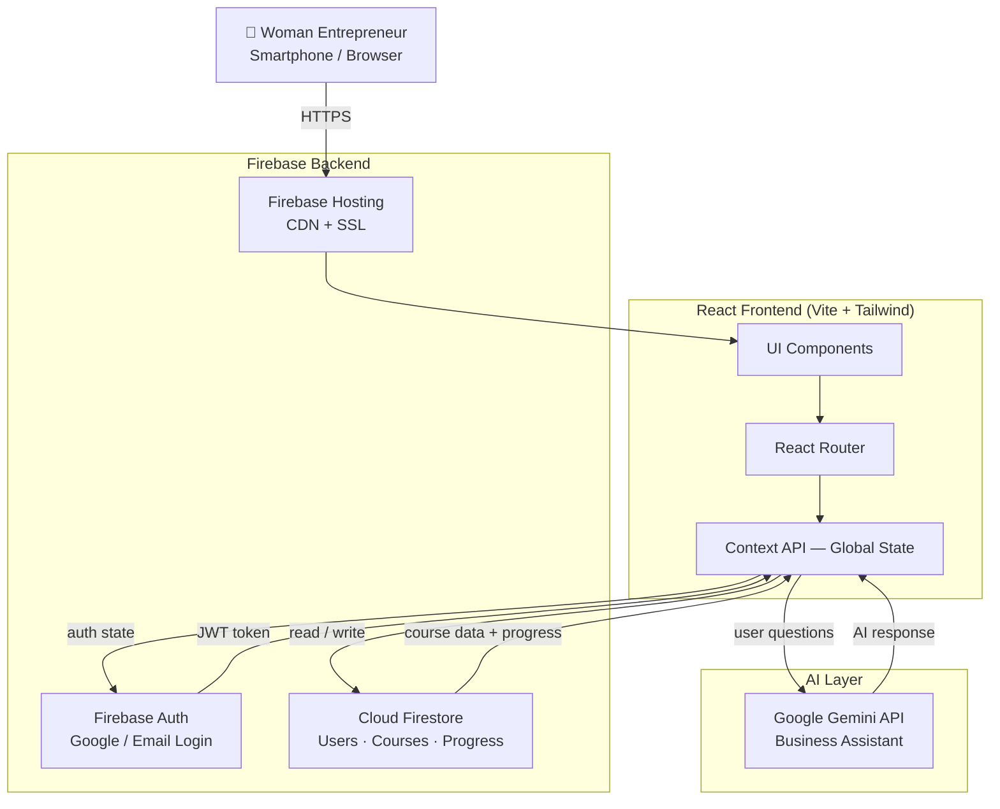

<div align="center">

<!-- ANIMATED HERO — emoji-free lines so the SVG URL parses cleanly -->


<br/>

<h3><em>A Regional E-Learning Platform for Women Entrepreneurs across India</em></h3>

<p align="center">
  <b>Financial Literacy &nbsp;·&nbsp; Digital Skills &nbsp;·&nbsp; Business Management &nbsp;·&nbsp; Entrepreneurship &nbsp;·&nbsp; Regional Languages</b>
</p>

<br/>

<!-- BADGE ROW 1 -->
<p>
  
  
  
  
</p>

<!-- BADGE ROW 2 -->
<p>
  
  
  
  
  
</p>

<br/>

<!-- QUICK NAV -->
<a href="#-about-the-project">About</a> &nbsp;·&nbsp;
<a href="#-problem-statement">Problem</a> &nbsp;·&nbsp;
<a href="#-key-features">Features</a> &nbsp;·&nbsp;
<a href="#-technology-stack">Tech Stack</a> &nbsp;·&nbsp;
<a href="#-system-architecture">Architecture</a> &nbsp;·&nbsp;
<a href="#-project-structure">Structure</a> &nbsp;·&nbsp;
<a href="#-getting-started">Getting Started</a> &nbsp;·&nbsp;
<a href="#-roadmap">Roadmap</a> &nbsp;·&nbsp;
<a href="#-contributing">Contribute</a>

<br/><br/>

</div>

---

## 📋 Table of Contents

- [About the Project](#-about-the-project)
- [Problem Statement](#-problem-statement)
- [Our Solution](#-our-solution)
- [Key Features](#-key-features)
- [Screenshots](#-screenshots)
- [Technology Stack](#-technology-stack)
- [System Architecture](#-system-architecture)
- [Project Structure](#-project-structure)
- [Getting Started](#-getting-started)
  - [Prerequisites](#prerequisites)
  - [Installation](#installation)
  - [Environment Variables](#environment-variables)
  - [Firebase Setup](#firebase-setup)
  - [Running Locally](#running-locally)
- [Available Scripts](#-available-scripts)
- [Security and Privacy](#-security-and-privacy)
- [Deployment](#-deployment)
- [Roadmap](#-roadmap)
- [Contributing](#-contributing)
- [License](#-license)
- [Acknowledgements](#-acknowledgements)
- [Contact](#-contact)

---

## 🌿 About the Project

**SakhiBiz** is an open-source, regional-language e-learning platform designed specifically for **rural and semi-urban women entrepreneurs** across India. The platform bridges the gap between formal business education and the millions of self-employed women — artisans, shopkeepers, home-based producers, micro-enterprise owners — who lack access to affordable, accessible, and culturally relevant business knowledge.

Unlike generic online learning platforms that assume English fluency and urban internet access, SakhiBiz delivers **bite-sized, practical lessons** in regional languages, covering the exact skills women entrepreneurs need: understanding profit margins, pricing their products fairly, managing expenses, using digital payment tools, protecting themselves online, and growing their customer base.

> *"Knowledge should never be a privilege. When a woman understands her business, her family and community grow with her."*

---

## 🎯 Problem Statement

Despite India having over **63 million micro, small, and medium enterprises**, a significant portion run by women face deep structural barriers to business growth:

| Challenge | Impact |
|-----------|--------|
| 🔤 **Language barriers** | Most business education is in English or formal Hindi, excluding regional-language speakers |
| 📊 **Financial literacy gap** | Many entrepreneurs cannot calculate profit, track expenses, or understand pricing |
| 📵 **Limited digital access** | Complex apps designed for urban users are unusable for first-time smartphone owners |
| 🏫 **No structured learning** | No beginner-friendly, step-by-step curriculum for micro-business management |
| 🔒 **Digital safety risks** | Vulnerable to online fraud, fake UPI requests, and misinformation |
| 💸 **No practical tools** | Spreadsheets and accounting software are inaccessible without training |

---

## 💡 Our Solution

SakhiBiz addresses these challenges through:

<table>
  <tr>
    <td align="center">🗣️</td>
    <td><b>Regional Language Education</b><br/>Courses and UI available in Hindi and other regional languages, making learning comfortable for first-time digital learners</td>
  </tr>
  <tr>
    <td align="center">📚</td>
    <td><b>Structured Learning Paths</b><br/>Beginner-to-advanced curricula covering financial literacy, marketing, digital tools, and business planning</td>
  </tr>
  <tr>
    <td align="center">🧮</td>
    <td><b>Practical Business Tools</b><br/>Built-in profit calculator and expense tracker so women can apply lessons immediately to their real businesses</td>
  </tr>
  <tr>
    <td align="center">🤖</td>
    <td><b>AI-Powered Assistance</b><br/>Conversational AI guide powered by Google Gemini — answers business questions in plain, accessible language</td>
  </tr>
  <tr>
    <td align="center">📱</td>
    <td><b>Mobile-First Design</b><br/>Optimized for low-end smartphones and slower internet connections used in Tier 2–3 cities and rural areas</td>
  </tr>
  <tr>
    <td align="center">🛡️</td>
    <td><b>Digital Safety Education</b><br/>Dedicated module teaching women to recognize fraud, protect their UPI credentials, and stay safe online</td>
  </tr>
</table>

---

## ✨ Key Features

### 🎓 Learning & Education

| Feature | Description | Status |
|---------|-------------|--------|
| 📖 **Course Catalogue** | Organized library of business courses by topic and skill level | ✅ Implemented |
| 🎯 **Structured Lessons** | Step-by-step lessons with clear objectives and takeaways | ✅ Implemented |
| 📊 **Progress Tracking** | Personal learning dashboard showing completed lessons and progress | ✅ Implemented |
| 🧠 **Quizzes & Assessments** | Comprehension checks after each lesson module | ✅ Implemented |
| 🌐 **Regional Language Content** | Hindi-first content with regional language support | ✅ Implemented |

### 💼 Business Tools

| Feature | Description | Status |
|---------|-------------|--------|
| 🧮 **Profit Calculator** | Calculate selling price, cost, and profit margin in seconds | ✅ Implemented |
| 📒 **Expense Tracker** | Log and categorize daily business expenses | ✅ Implemented |
| 📋 **Business Planning Resources** | Guided templates and planning tools for micro-enterprises | ✅ Implemented |
| 💹 **Financial Literacy Module** | Practical lessons on budgeting, savings, and pricing | ✅ Implemented |

### 🛡️ Safety & Identity

| Feature | Description | Status |
|---------|-------------|--------|
| 🔐 **Digital Safety Education** | Courses on online fraud, UPI safety, and cyber hygiene | ✅ Implemented |
| 👤 **Personalized Dashboard** | Individual learner profile with recommended courses | ✅ Implemented |
| 🤖 **AI Learning Assistant** | Ask business questions, get plain-language answers via Gemini AI | ✅ Implemented |
| 🔑 **Secure Authentication** | Google Sign-In and email/password via Firebase Auth | ✅ Implemented |

### 🔮 Planned

| Feature | Status |
|---------|--------|
| 🗣️ Voice-based lessons for low-literacy users | 🔲 Planned |
| 📥 Downloadable offline lesson packs | 🔲 Planned |
| 🏅 Certificates on course completion | 🔲 Planned |
| 👥 Peer community and mentor network | 🔲 Planned |
| 📲 Progressive Web App (PWA) offline support | 🔲 Planned |

---

## 📸 Screenshots

> Screenshots will be added here after the first deployment.

To add your own screenshots, place them under `public/screenshots/` and use:

```md
<p align="center">
  
  
</p>
```

**Live Demo:** _Not yet deployed — link will be added here_

---

## 🛠 Technology Stack

### Frontend

| Technology | Version | Role |
|------------|---------|------|
| ⚛️ **React** | 18.x | Core UI library, component architecture |
| ⚡ **Vite** | 5.x | Build tool and development server |
| 🎨 **Tailwind CSS** | 3.x | Utility-first CSS styling |
| 🔀 **React Router** | 6.x | Client-side routing and navigation |

### Backend & Database

| Technology | Role |
|------------|------|
| 🔥 **Firebase Firestore** | NoSQL database for user data, course content, progress |
| 🔐 **Firebase Authentication** | Google OAuth and email/password auth |
| 🌐 **Firebase Hosting** | Static hosting with CDN for production deployment |

### AI Integration

| Technology | Role |
|------------|------|
| 🤖 **Google Gemini API** | AI-powered business assistant, Q&A, lesson explanations |

### Development Tools

| Technology | Role |
|------------|------|
| 🔍 **ESLint** | Code quality and linting |
| 📦 **npm** | Package management |
| 🗂️ **Git** | Version control |

---

## 🏗 System Architecture



**Component responsibilities:**

- **React Frontend** — All UI rendering, routing, and user interactions. State managed via React Context.
- **Firebase Auth** — Handles user identity. Issues JWT tokens validated by Firestore security rules.
- **Cloud Firestore** — Stores profiles, course content, quiz results, and progress. Locked down by Firestore Rules.
- **Google Gemini** — Provides the AI business assistant. Queries sent from the frontend; responses streamed back.
- **Firebase Hosting** — Serves the production build from a global CDN with automatic SSL.

---

## 📁 Project Structure

```
SakhiBiz/
├── public/                      # Static assets served directly
│   ├── favicon.ico
│   └── screenshots/             # Add app screenshots here
│
├── src/
│   ├── assets/                  # Images, icons, illustrations
│   ├── components/              # Reusable UI components
│   │   ├── Navbar.jsx
│   │   ├── CourseCard.jsx
│   │   ├── LessonViewer.jsx
│   │   ├── QuizModule.jsx
│   │   ├── ProgressBar.jsx
│   │   ├── AIAssistant.jsx
│   │   └── ...
│   ├── pages/                   # Top-level route pages
│   │   ├── Home.jsx
│   │   ├── Dashboard.jsx
│   │   ├── Courses.jsx
│   │   ├── LessonPage.jsx
│   │   ├── BusinessTools.jsx
│   │   ├── ProfitCalculator.jsx
│   │   ├── ExpenseTracker.jsx
│   │   ├── Login.jsx
│   │   └── ...
│   ├── context/                 # React Context providers
│   │   ├── AuthContext.jsx      # Firebase auth state
│   │   └── AppContext.jsx       # Global app state
│   ├── firebase/                # Firebase configuration
│   │   ├── config.js            # Firebase app init (uses env vars)
│   │   └── firestore.js         # Firestore helper functions
│   ├── services/                # External service integrations
│   │   └── gemini.js            # Google Gemini API calls
│   ├── utils/                   # Pure utility functions
│   ├── hooks/                   # Custom React hooks
│   ├── App.jsx                  # Root component + routing
│   └── main.jsx                 # App entry point
│
├── .env.example                 # Environment variable template
├── .gitignore
├── package.json
├── vite.config.js
├── tailwind.config.js
├── firestore.rules              # Firestore security rules
└── README.md
```

---

## 🚀 Getting Started

### Prerequisites

| Tool | Minimum Version | Check |
|------|----------------|-------|
| **Node.js** | 18.x or later | `node --version` |
| **npm** | 9.x or later | `npm --version` |
| **Git** | Any recent | `git --version` |

You also need:
- A **Firebase** account (free tier works) → [console.firebase.google.com](https://console.firebase.google.com)
- A **Google AI Studio** account for the Gemini key → [aistudio.google.com](https://aistudio.google.com)

---

### Installation

**1. Clone the repository**

```bash
git clone https://github.com/YOUR_GITHUB_USERNAME/SakhiBiz.git
cd SakhiBiz
```

**2. Install dependencies**

```bash
npm install
```

---

### Environment Variables

Copy the template and fill in your own values:

```bash
cp .env.example .env
```

**`.env.example`**

```env
# ── Firebase Configuration ──────────────────────────────────────────────────
# Firebase Console → Project Settings → Your Apps → Web App
VITE_FIREBASE_API_KEY=YOUR_FIREBASE_API_KEY_HERE
VITE_FIREBASE_AUTH_DOMAIN=YOUR_PROJECT_ID.firebaseapp.com
VITE_FIREBASE_PROJECT_ID=YOUR_PROJECT_ID_HERE
VITE_FIREBASE_STORAGE_BUCKET=YOUR_PROJECT_ID.appspot.com
VITE_FIREBASE_MESSAGING_SENDER_ID=YOUR_SENDER_ID_HERE
VITE_FIREBASE_APP_ID=YOUR_FIREBASE_APP_ID_HERE

# ── Google Gemini AI ─────────────────────────────────────────────────────────
# https://aistudio.google.com/app/apikey
VITE_GEMINI_API_KEY=YOUR_GEMINI_API_KEY_HERE
```

> ⚠️ All variables use the `VITE_` prefix — required by Vite to expose them to the frontend. Never commit your actual `.env` file.

---

### Firebase Setup

**Step 1:** Create a Firebase project at [console.firebase.google.com](https://console.firebase.google.com)

**Step 2:** Register a Web App → copy the `firebaseConfig` values into `.env`

**Step 3:** Enable Authentication providers
- Go to **Authentication → Sign-in method**
- Enable **Google** and/or **Email/Password**
- Add `localhost` to authorized domains

**Step 4:** Create a Firestore database
- Go to **Firestore Database → Create database**
- Start in **test mode** for local dev
- Choose region `asia-south1` (recommended for India)

**Step 5:** Apply security rules
- Open `firestore.rules` from the project root
- Paste the contents into **Firestore → Rules** → **Publish**

---

### Running Locally

```bash
npm run dev
```

Open **http://localhost:5173** in your browser.

---

## 📜 Available Scripts

| Command | Description |
|---------|-------------|
| `npm run dev` | Start the Vite development server with hot-reload |
| `npm run build` | Create an optimized production build in `/dist` |
| `npm run preview` | Preview the production build locally |
| `npm run lint` | Run ESLint to check for code issues |

---

## 🔒 Security and Privacy

SakhiBiz handles personal data from vulnerable users. Security is a first-class concern.

**Implemented practices:**

- **Authentication** — Firebase Auth handles all identity management. Passwords are never stored by the application.
- **Authorization** — Firestore Security Rules enforce that users can only read and write their own documents.
- **Secret Management** — All API keys live in environment variables and are excluded from version control via `.gitignore`.
- **Input Validation** — User inputs are validated on the frontend before being written to Firestore.
- **HTTPS Only** — Firebase Hosting serves all content over HTTPS with automatic SSL.

**Important reminder for users:**

> ⚠️ SakhiBiz will **never** ask for your UPI PIN, bank password, or OTP. Do not share login credentials with anyone.

**Responsible disclosure:** If you discover a security vulnerability, please **do not open a public issue**. Email the maintainer directly (see [Contact](#-contact)) with the subject `[SECURITY] SakhiBiz`. We aim to respond within 72 hours.

---

## ☁️ Deployment

SakhiBiz deploys to **Firebase Hosting**.

**1. Install the Firebase CLI**

```bash
npm install -g firebase-tools
```

**2. Log in and initialize**

```bash
firebase login
firebase init hosting
# Public directory → dist
# Single-page app   → Yes
# Overwrite dist/index.html → No
```

**3. Build and deploy**

```bash
npm run build
firebase deploy --only hosting
```

Firebase provides a live URL like `https://YOUR_PROJECT_ID.web.app`.

> 💡 **Alternative:** This Vite app also deploys on **Vercel** or **Netlify** — set build command to `npm run build` and output directory to `dist`. Add environment variables in your platform's dashboard.

---

## 🗺️ Roadmap

### ✅ Completed

- [x] Project scaffold — React + Vite + Tailwind CSS
- [x] Firebase Authentication (Google + Email/Password)
- [x] Cloud Firestore integration
- [x] Course catalogue with structured lessons
- [x] Learning progress tracking
- [x] Quiz and assessment modules
- [x] Profit calculator tool
- [x] Expense tracker tool
- [x] Financial literacy course module
- [x] Digital safety education module
- [x] Google Gemini AI business assistant
- [x] Hindi-first content and UI
- [x] Mobile-responsive design

### 🔄 In Progress

- [ ] Expanding regional language support (Marathi, Bengali, Tamil)
- [ ] Additional business tools (invoice generator, stock tracker)
- [ ] Improved AI assistant context and accuracy
- [ ] Accessibility improvements (ARIA, keyboard navigation)

### 🔮 Planned

- [ ] Progressive Web App (PWA) with offline lesson access
- [ ] Downloadable PDF lesson summaries
- [ ] Voice-based lessons for low-literacy users
- [ ] Course completion certificates
- [ ] Peer community and discussion forum
- [ ] Mentor matching feature
- [ ] Government scheme navigator for women entrepreneurs
- [ ] Integration with UPI and digital payment education

---

## 🤝 Contributing

Contributions are what make open source meaningful. SakhiBiz particularly welcomes contributions that help underserved communities.

**1. Fork the repository**

```bash
git clone https://github.com/YOUR_USERNAME/SakhiBiz.git
```

**2. Create a feature branch**

```bash
git checkout -b feature/your-feature-name
# e.g. feature/marathi-translations
#      fix/quiz-score-bug
#      docs/improve-setup-guide
```

**3. Make focused changes, then run checks**

```bash
npm run lint
npm run build   # must succeed before opening a PR
```

**4. Commit with a meaningful message**

```bash
git commit -m "feat: add Marathi translations for financial literacy module"
```

**5. Push and open a pull request**

```bash
git push origin feature/your-feature-name
```

Open a PR on GitHub with a clear title and description.

**We especially welcome contributions involving:**

- 🌐 Regional language translations (Marathi, Bengali, Tamil, Telugu, Kannada, Gujarati)
- 📚 Educational content — new lessons, quizzes, business case studies
- ♿ Accessibility — ARIA, keyboard navigation, screen reader support
- 🐛 Bug fixes
- 🎨 UI improvements — better mobile experience, readability
- 📖 Documentation
- 🧪 Tests

---

## 📄 License

> ⚠️ **No license has been specified in this repository yet.**

A license is required for others to legally use, modify, or distribute this software. Recommended options:

| License | Best for |
|---------|----------|
| [MIT](https://choosealicense.com/licenses/mit/) | Maximum openness, commercial use allowed |
| [Apache 2.0](https://choosealicense.com/licenses/apache-2.0/) | Openness + explicit patent protection |
| [GPL v3](https://choosealicense.com/licenses/gpl-3.0/) | Ensures all derivatives stay open-source |

Visit [choosealicense.com](https://choosealicense.com) to pick one, then add a `LICENSE` file to the repository.

---

## 🙏 Acknowledgements

- [React](https://react.dev/) — UI library
- [Vite](https://vitejs.dev/) — Build tooling
- [Tailwind CSS](https://tailwindcss.com/) — Styling
- [Firebase](https://firebase.google.com/) — Auth, database, and hosting
- [Google Gemini](https://deepmind.google/technologies/gemini/) — AI assistance
- [React Router](https://reactrouter.com/) — Client-side navigation
- [Shields.io](https://shields.io/) — README badges
- [readme-typing-svg](https://github.com/DenverCoder1/readme-typing-svg) — Animated hero text

Special thanks to the women entrepreneurs whose lived experiences and feedback shaped this platform.

---

## 📬 Contact

| | |
|--|--|
| **Project** | SakhiBiz — Regional E-Learning for Women Entrepreneurs |
| **GitHub** | [github.com/YOUR_USERNAME/SakhiBiz](https://github.com/YOUR_USERNAME/SakhiBiz) |
| **Issues** | [github.com/YOUR_USERNAME/SakhiBiz/issues](https://github.com/YOUR_USERNAME/SakhiBiz/issues) |
| **Maintainer** | [@YOUR_GITHUB_USERNAME](https://github.com/YOUR_GITHUB_USERNAME) |
| **Email** | `your.email@example.com` |
| **Live Demo** | _Not yet deployed_ |

---

<div align="center">


<br/>

**⭐ If SakhiBiz inspires or helps you, please star the repository — it helps others find this project.**

<br/>

*SakhiBiz — Empowering Women, One Skill at a Time*

</div>
